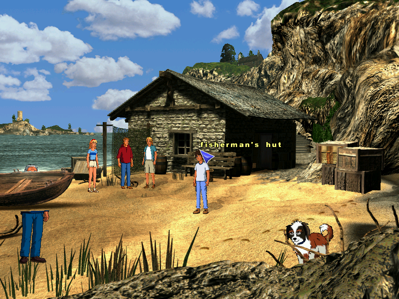
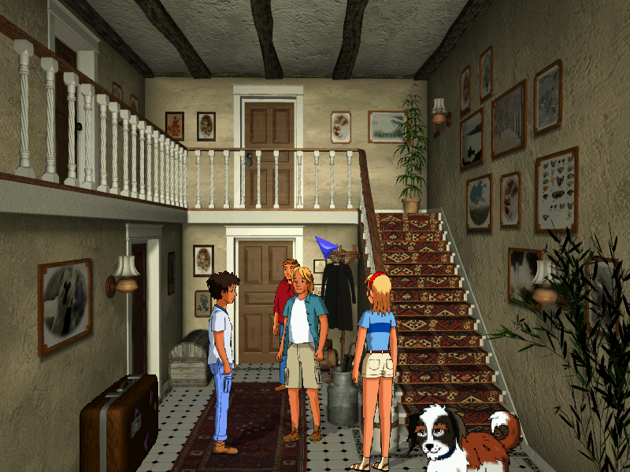
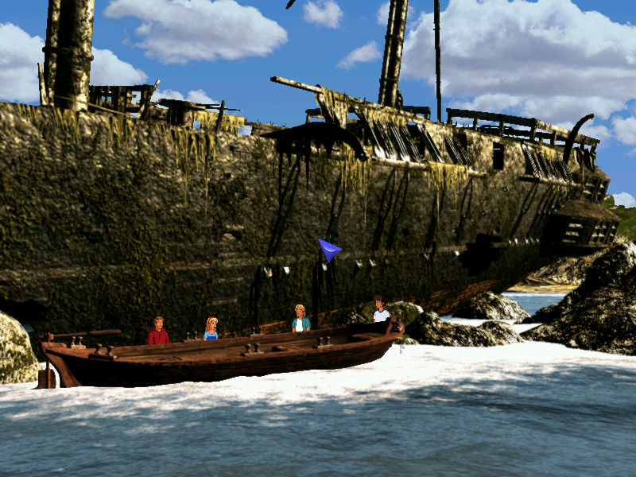
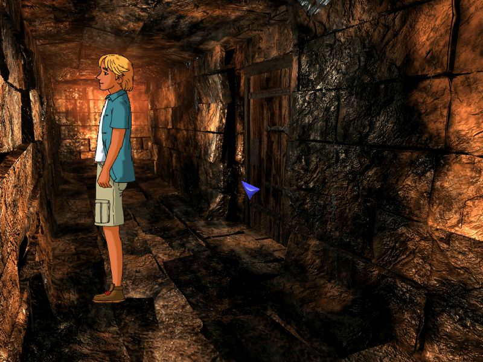

<div align="center">


# OpenFive

**Play *The Famous Five: Treasure Island* (1999) on modern computers.**

[](https://github.com/benorrin/openfive/actions/workflows/build.yml)
[](https://github.com/benorrin/openfive/releases/latest)
[](https://github.com/benorrin/openfive/releases)
[](LICENSE)
[](#download)
[](#download)
[](#download)



</div>

OpenFive is a free, open-source remake of the engine behind **The Famous Five: Treasure Island**
(*5 Freunde auf Schatzsuche*, Ravensburger Interactive, 1999). Pop in your old CD (or a disc
image of it) and play the original adventure again, in a window or fullscreen, at any size, with
no emulator or old copy of Windows needed.

* 🗺️ **The whole adventure**, from the intro to the closing credits
* 🇬🇧🇩🇪 **English and German**: both languages are on every CD; switch with the flag in the options menu
* 🖥️ **Any window size or fullscreen**, with smooth or sharp pixel scaling
* 💾 **Save and load** at any time

> [!IMPORTANT]
> OpenFive does **not** include the game itself. You need your own copy of the original
> *Famous Five: Treasure Island* CD (English or German). OpenFive reads the graphics, speech and
> music from it every time it runs.

## Download

Get the latest version from the **[Releases page](https://github.com/benorrin/openfive/releases/latest)**.
Everything OpenFive needs is included: there is nothing else to install.

| You use | Download | Then |
|---------|----------|------|
| 🪟 **Windows** 10 or 11 | `OpenFive-…-windows-x64.zip` | Unzip it anywhere and double-click `OpenFive.exe`. |
| 🍎 **Mac** with Apple silicon (M1 or later) | `OpenFive-…-macos-arm64.dmg` | Open it and drag OpenFive into Applications. |
| 🍎 **Mac** with an Intel processor | `OpenFive-…-macos-x64.dmg` | Open it and drag OpenFive into Applications. |
| 🐧 **Debian, Ubuntu**, Mint, Pop!_OS | `openfive_…_amd64.deb` | Double-click to install, or `sudo apt install ./openfive_*.deb`. |
| 🦎 **openSUSE** | `openfive-…x86_64.rpm` | `sudo zypper install --allow-unsigned-rpm ./openfive-*.rpm` |
| 🎩 **Fedora** | `openfive-…x86_64.rpm` | Double-click to install, or `sudo dnf install ./openfive-*.rpm`. |
| 🐧 **Any other Linux** | `openfive-…-linux-x64.tar.gz` | Unpack it anywhere and run `./openfive`. |

On a Raspberry Pi or other ARM Linux machine, pick the `arm64`/`aarch64` file instead of
`amd64`/`x64`/`x86_64`. The Linux packages add OpenFive to your applications menu.

<details>
<summary><b>Windows or macOS says the app is from an unknown developer</b></summary>

OpenFive is a free hobby project and isn't signed with a paid Microsoft or Apple certificate, so
the first time you open it your system will warn you:

* **Windows** ("Windows protected your PC"): click **More info**, then **Run anyway**.
* **macOS** ("OpenFive cannot be opened"): click **Done**, open **System Settings → Privacy &
  Security**, scroll down and click **Open Anyway** next to OpenFive.

You only need to do this once.
</details>

## Getting started

1. **Start OpenFive.**
2. **Show it your game.** If the CD is in the drive, OpenFive finds it by itself. Otherwise it asks
   you to choose a disc image of the CD (a `.cue`, `.ccd`, `.iso`, `.img` or `.bin` file).
3. **Play!** OpenFive remembers where the game is, so next time it starts straight away.

> [!TIP]
> A disc image saves you from needing the CD in the drive, and loads faster. Any CD imaging tool
> works. On Linux:
>
> ```sh
> dd if=/dev/sr0 of=famous5.iso bs=2048 status=progress
> ```
>
> On Linux you can also give the image on the command line: `openfive --disc ~/Games/famous5.iso`.

## How to play

You play the Famous Five (mostly George and Dick) on the trail of a treasure on Kirrin Island.
Explore each place, talk to everyone and look closely at things: the pointer flashes red over
anything you can interact with. Stuck? Talk to the others again; they often have a hint.

<p align="center">
  
  
  
</p>

### Controls

| | |
|---|---|
| **Click** | Walk, look at things, talk to people, pick things up |
| **Click your character** | Open the rucksack (inventory) |
| **Use an item** | Click it in the rucksack, then click what to use it on: something in the scene, a person, or another item |
| **Click** or **Space** during speech | Skip the current line |
| **F1** | Main menu: load, save, options, quit |
| **Esc** | Back to the game from a menu |
| **F11** or **Alt+Enter** | Toggle fullscreen |
| **F12** | Toggle smooth / sharp scaling |

To save, press **F1**, choose *Save game*, click a slot, type a name and press **Enter**.

## Command-line options

You won't need these to play, but they're there if you start OpenFive from a terminal:

| Option | What it does |
|--------|--------------|
| `--disc PATH` | Disc image or mounted CD to use (or set `OPENFIVE_DISC`) |
| `--lang en` / `--lang de` | Play in English or German |
| `--fullscreen` | Start fullscreen |
| `--sharp` | Sharp pixel scaling instead of smooth |
| `--skip-intro` | Start at the main menu |

Settings and saved games are kept in:

* **Windows:** `%APPDATA%\OpenFive`
* **macOS:** `~/Library/Application Support/OpenFive`
* **Linux:** `~/.local/share/openfive`

Set `OPENFIVE_HOME` to use a different folder.

## Help and feedback

The game can be played all the way through, but not every side path has been tried yet. If
something goes wrong, please [open an issue](https://github.com/benorrin/openfive/issues) and
say where you were in the game; a saved game helps a lot. For detailed status, see
[docs/PROGRESS.md](docs/PROGRESS.md).

Want to build OpenFive yourself or help out? See **[docs/DEVELOPING.md](docs/DEVELOPING.md)**.

## Legal

OpenFive is an independent fan project, not affiliated with or endorsed by Ravensburger or the
rights holders of *The Famous Five*. "The Famous Five" is a trademark of its respective owner.
The program contains no code, graphics, text, speech or music from the original game; the
screenshots above show it running with an original CD. You need a legally obtained copy of the
game to play.

OpenFive is free software, licensed under the GNU General Public License, version 2 (see
[LICENSE](LICENSE)). It comes with no warranty.
